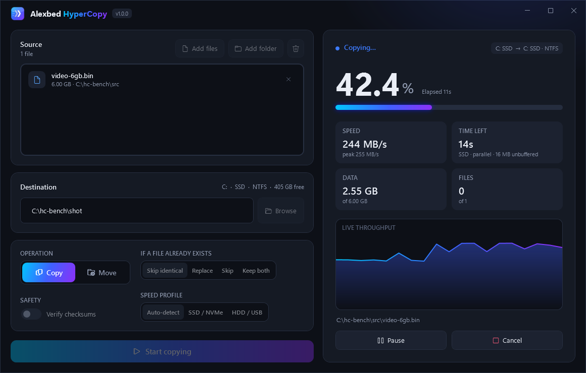
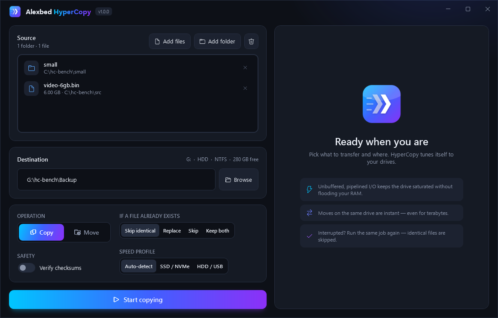
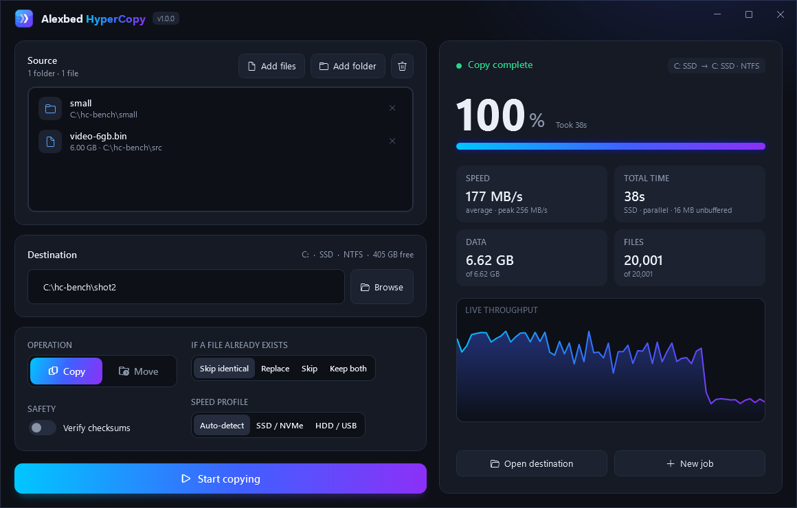

<p align="center">
  
</p>

<h1 align="center">Alexbed HyperCopy</h1>

<p align="center">
  <b>Copy and move terabytes at full disk speed.</b><br>
  A portable, free file copier for Windows 10/11: one <code>.exe</code>, no installer, no registry footprint.
</p>

<p align="center">
  <a href="../../releases/latest"></a>
  <a href="LICENSE"></a>
  
  <a href="../../actions"></a>
</p>

**Version:** 1.0.0 &nbsp;|&nbsp; **Author:** Alexander Bediako &nbsp;|&nbsp; **Licence:** [GPL-3.0-or-later](LICENSE)



- **Fast where it counts.** Big files are copied with unbuffered, pipelined I/O. On SSDs this
  measured 15–20% faster than Robocopy and Windows Explorer's copy engine ([benchmarks](docs/benchmark-results.md)).
- **Knows your drives.** It detects SSD, hard disk, USB and network drives and tunes itself for each.
  Hard disks and USB sticks get one smooth sequential stream; SSDs get parallel work.
- **Doesn't slow your PC down.** Large copies bypass the Windows file cache, so copying 2 TB won't fill
  your RAM or make other programs stutter.
- **Safe.** It can verify every file with a checksum, and a cancelled file is never left half-written.
  It warns you *before* starting when space is short or a file is too big for a FAT32 USB stick.
- **Resumable.** Interrupted? Run the same job again; files that are already identical are skipped.
- **Instant moves.** Moving files within the same drive is a rename, so even terabytes take a moment.

## Download

Get **`AlexbedHyperCopy.exe`** from the [latest release](../../releases/latest) and run it. No install
is needed, so it also runs from a USB stick.

Windows SmartScreen may warn about an unknown publisher, because the exe isn't code-signed yet.
Choose *More info → Run anyway*. To check the download is genuine, compare its SHA-256 with
`SHA256SUMS.txt` on the release page:

```powershell
Get-FileHash .\AlexbedHyperCopy.exe -Algorithm SHA256
```

## Using it

| 1. Choose what and where | 2. Watch it go | 3. Done |
|---|---|---|
|  |  |  |

1. **Add sources:** drag files or folders onto the window, or use *Add files* / *Add folder*.
   You can add a whole drive.
2. **Pick the destination:** a folder, another drive or a USB stick. The app shows the drive type,
   file system and free space.
3. **Copy or Move.**
4. **If a file already exists:**

   | Option | What happens |
   |---|---|
   | **Skip identical** (default) | Skips files with the same size and date, and replaces the rest. This lets you resume a job. |
   | **Replace** | Always overwrites. |
   | **Skip** | Never touches existing files. |
   | **Keep both** | Saves the new file as `name (2).ext`. |

5. **Verify checksums** (optional): every file is read back from the disk and compared with the original
   (XXH3). It takes longer, but you get certainty for backups.
6. **Speed profile:** leave it on *Auto-detect* unless you know better.
7. Press **Start**. You can pause, resume or cancel at any time. Problems are listed with a reason, and
   *Copy list* puts them on the clipboard.

During a transfer, the taskbar icon shows progress and your PC won't go to sleep.

## How it's fast

| Technique | What it does |
|---|---|
| **Unbuffered, pipelined I/O** | A reader thread and writer threads share a ring of sector-aligned 16–64 MB buffers. Reads and writes overlap fully and bypass the file cache. |
| **Drive probing** | Windows is asked whether each drive has a *seek penalty* (HDD) and which bus it's on (USB/SD). This sets threads, buffer size and write depth. |
| **Tuned write depth** | SSDs get 2 writes in flight. HDDs get exactly 1, because measurements showed that extra concurrent writes make the heads seek (−12% to −35%). |
| **Pre-allocation** | Each destination file is reserved at full size first. This reduces fragmentation, and a full disk is detected up front. |
| **Kernel copy for small files** | Small files go through Windows' CopyFileEx on many threads. That measured 4–8× faster than opening the files ourselves. |
| **Inline hashing** | The source is checksummed while it is read, so verification needs only one read of the copy. |

### Measured

| | HyperCopy | Robocopy | Explorer engine |
|---|---:|---:|---:|
| 6 GB file, SSD | **25 s** | 31 s (`/J`) | 30 s |
| 36 GB file, SSD → SSD | **459 s** | 483 s | 491 s |
| 6 GB file, SSD → HDD | **69 s** | 67 s\* | 70 s |
| 20,000 small files, SSD | 11 s | **5 s** (`/MT:16`) | – |

\* Robocopy measured without flushing to disk. Thousands of tiny files on an SSD is the one case where
Robocopy `/MT` is still ahead; closing that gap is the main goal for v1.1 (see [ROADMAP.md](ROADMAP.md)).
Full method and raw numbers: [docs/benchmark-results.md](docs/benchmark-results.md).

## Command line

Pre-fill the window from a script or shortcut:

```powershell
AlexbedHyperCopy.exe "D:\Photos" "D:\Videos" --to "E:\Backup"
```

For fully automated jobs, the release also includes **`hypercopy.exe`**, a console version:

```powershell
hypercopy copy <source>... <destination> [--verify] [--conflict skip-identical|overwrite|skip|keep-both]
hypercopy move <source>... <destination> [--profile auto|ssd|hdd] [--threads N] [--buffer-mb N] [--quiet]
```

It returns exit code `0` when everything succeeded, so it suits scheduled backups.

## Build from source

You need Windows and the [.NET 10 SDK](https://dotnet.microsoft.com/download).

```powershell
dotnet test                                          # 35 tests, about 15 s
powershell -ExecutionPolicy Bypass -File build.ps1   # tests + portable exes in dist\
```

`build.ps1` writes `dist\AlexbedHyperCopy.exe`, `dist\hypercopy.exe` and `dist\SHA256SUMS.txt`.

## Project docs

- [docs/ARCHITECTURE.md](docs/ARCHITECTURE.md): engine design, threading, safety model, code layout
- [docs/RESEARCH.md](docs/RESEARCH.md): how FastCopy, TeraCopy, Robocopy and others work, and what we took from them
- [docs/benchmark-results.md](docs/benchmark-results.md): every measurement, including where we lose
- [ROADMAP.md](ROADMAP.md) · [CHANGELOG.md](CHANGELOG.md) · [CONTRIBUTING.md](CONTRIBUTING.md) · [SECURITY.md](SECURITY.md)

## Licence

Alexbed HyperCopy is free software, released under the **GNU General Public License v3.0 or later**.
You may use it for free, and study, share and change it. See [LICENSE](LICENSE).

It's built on .NET, WPF and System.IO.Hashing (MIT licence). See
[THIRD-PARTY-NOTICES.txt](THIRD-PARTY-NOTICES.txt).
